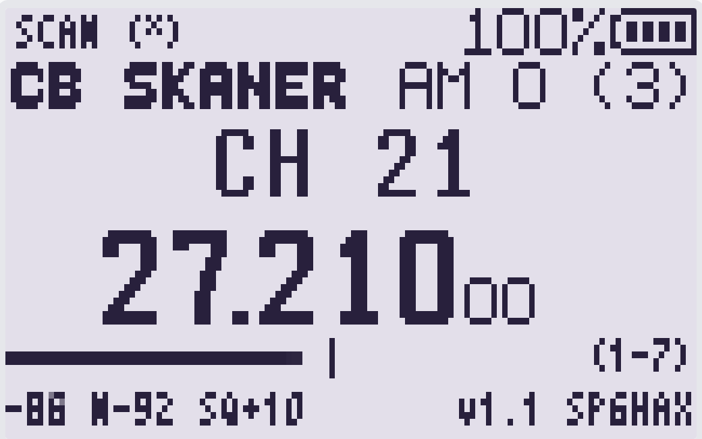

# Skan80 – CB-80-Kanal-Scanner für UV-K1 / UV-K5 V3

**F4HWN Labs Overlay-App**, nur Empfang (RX), 80 deutsche CB-Kanäle.  
Basierend auf [CBSkaner von Kriss80 / SP6HAX](https://github.com/Kriss80/uv-k1-cb). Die ursprüngliche Apache-2.0-Lizenz und der Urheberhinweis bleiben erhalten. Die 80-Kanal-Erweiterung wurde für DO7OO erstellt.



## Frequenzen (Deutschland)

Die [Bundesnetzagentur, Allgemeinzuteilung Vfg. 21/2021](https://www.bundesnetzagentur.de/865198) legt diese 80 Mittenfrequenzen fest.

- **Kanal 1–40:** 26,965 bis 27,405 MHz; die Kanalnummern sind wegen der fünf Rasterlücken und der vertauschten Kanäle 23/24/25 **nicht** durchgehend frequenzaufsteigend. Kanal 19: **27,185 MHz**, 23: **27,255**, 24: **27,235**, 25: **27,245** MHz.
- **Kanal 41–80:** 26,565 bis 26,955 MHz in 10-kHz-Schritten. 41 = **26,565 MHz**, 80 = **26,955 MHz**.
- Deutsche Mittenfrequenzen immer im **5-kHz-Raster**, kein polnischer 0-kHz-Versatz. FM auf allen 80 Kanälen; AM-Empfang optional auf Kanal 1–40. 41–80 werden unabhängig von der AM-Voreinstellung immer auf FM geschaltet.

Die App ist **empfangsseitig** implementiert; sie ruft keinerlei TX-Funktionen auf. Ein UV-K1 ist nicht automatisch ein zugelassenes CB-Sendegerät!

## Bedienung

| Taste | Wirkung |
|---|---|
| UP / DOWN | einen Kanal auf / ab, 1–80 mit Umlauf |
| `*` | Scan starten oder anhalten |
| `3` | Scanbereich: **ALL** (1–80) → **LO** (1–40) → **HI** (41–80) → ALL |
| MENU | AM/FM **nur** auf Kanal 1–40 umschalten |
| `1` / `7` | Rauschsperre (RSSI über Rauschpegel) −2 / +2 dB |
| `5` | aktuellen Kanal vom Scan ausnehmen / wieder einschließen |
| `8` | letzten aktiven Kanal aufrufen |
| `9` | Kanal 19 (27,185 MHz) aufrufen |
| `0` | Monitor ein/aus (Rauschsperre übergehen) |
| EXIT | App verlassen |

**Wichtig:** LO/HI schränken nur die *Scanfolge* ein. Mit UP/DOWN kann man unabhängig davon stets alle 80 Kanäle wählen. Wenn ein Scanbereich vollständig auf SKIP steht, beendet die App den Suchlauf, statt endlos dieselbe Frequenz neu abzustimmen.

Ab Werk: Kanal 19, **FM**, **ALL**, SQ+10 dB. Kanal, Scanbereich, Skip-Liste und SQ werden beim Beenden gespeichert. Die alte CBSkaner-Konfiguration wird beim Laden erkannt, soweit sie der App zugänglich ist. Ein bisheriger 0-kHz-Rastermodus wird bewusst **nicht** übernommen.

Scan-Dwell: 150 ms pro Kanal (80 Kanäle nominell mindestens 12 s plus Umschaltaufwand). Bei erkanntem Signal bleibt der Empfänger stehen; nach 2 s ohne Signal wird der Scan fortgesetzt.

## Voraussetzungen

- Quansheng UV-K1 oder UV-K5 V3 mit **F4HWN Labs v6.3.0 oder neuer** (Overlay-API 3).
- Empfängertaugliche 27-MHz-Antenne. Das UV-K1 ist am 11-m-Band wegen der RF-Frontends und fehlenden passenden Filter empfindlichkeitsschwächer als ein echtes CB-Funkgerät.
- Zum Bauen auf Linux Mint 22: `python3`, `curl`, `arm-none-eabi-gcc`, `arm-none-eabi-objcopy`. Für den Host-Test `cc`.

## Bauen (Mint 22)

```bash
git clone https://github.com/DE8MSH/uv-k1-cb_80channel.git
cd uv-k1-cb_80channel
git switch skan80-80ch-v1
cc -std=c11 -Wall -Wextra -Werror -Isrc tests/test_channels.c -o /tmp/skan80-test
/tmp/skan80-test
./build.sh
sha256sum build/Skan80.app
```

Bei `./build.sh` werden die F4HWN-ABI-Dateien auf einem **festen Firmware-Commit** geholt; alternativ kann `F4HWN_DIR=/pfad/zum/firmware-repo ./build.sh` verwendet werden.

Die fertige Datei heißt `build/Skan80.app` (max. 4096 Byte App-Code). Bei GitHub Actions wird sie als Build-Artefakt angeboten.

**Installation:** In [UV Studio](https://armel.github.io/uvstudio/) unter **Apps** die Datei `Skan80.app` installieren; **nicht** als Firmware flashen. Dann am Gerät über F → 7 (Apps) starten.

### Hardware-Hinweis

Die Kanalzuordnung und Kompilierung lassen sich automatisch testen. Echtes RX-Verhalten auf dem Gerät (BK4819-Empfang bei 26,565 MHz, RSSI/Squelch, Scan und Antenne) benötigt zusätzlich einen Praxistest.

## Lizenz / Urheber

Apache License 2.0: [LICENSE](LICENSE), [NOTICE](NOTICE).  
Original CBSkaner: **Kriss80 Elektryczny SP6HAX**. Erweiterung: **Skan80 für DO7OO**.
